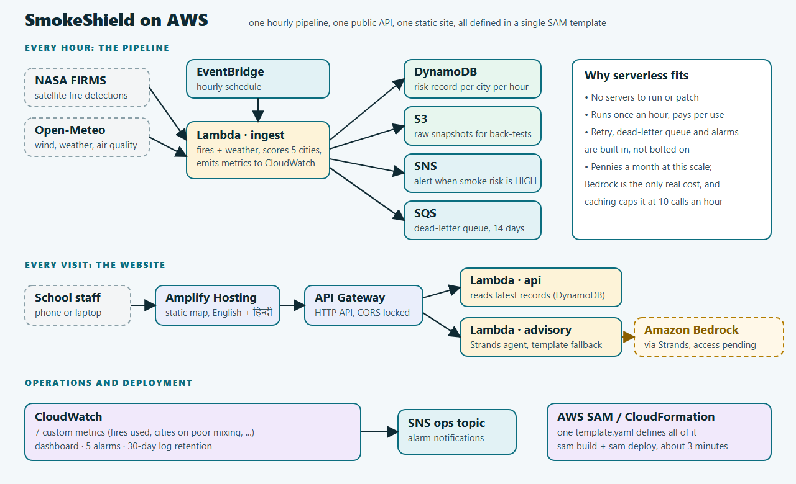
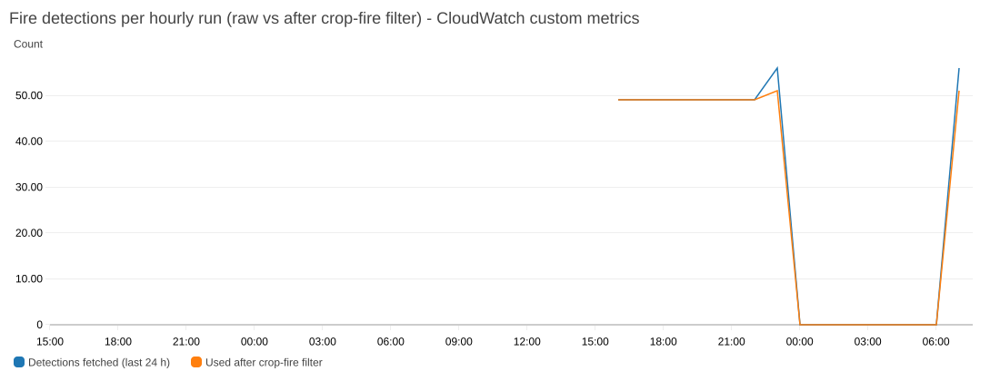

# When the Alarm Stayed Silent: Catching a Hidden Bug in Our AWS Smoke Forecast for Delhi Schools

*Tags: serverless, AWS Lambda, Amazon CloudWatch, Amazon DynamoDB, AWS SAM, Strands Agents, education, air quality*

Every October and November, smoke from crop fires in Punjab and Haryana drifts toward Delhi. On the worst mornings, a school principal has to decide, usually the night before, whether tomorrow's assembly, PE class and buses are okay.

Air-quality apps tell that principal how bad the air *is*. They don't say what to *do*. I built **SmokeShield** to close that gap: a serverless AWS pipeline that turns satellite fire detections and weather forecasts into a one-line recommendation (OK, Limit or Avoid), a school day planner, and a ready-to-send notice for parents, in English and Hindi.

This post is about how it runs on AWS. It is also about the most useful thing the build taught me: **a pipeline that never errors can still be wrong.**

## The architecture

Everything is defined in one AWS SAM template and deployed with `sam build` and `sam deploy`.



- **Amazon EventBridge** triggers the pipeline every hour.
- **AWS Lambda** (Python 3.12) runs three functions on a shared layer. `ingest` pulls NASA FIRMS fire detections and Open-Meteo weather and scores five cities. `api` serves the latest records. `advisory` writes the guidance.
- **Amazon DynamoDB** stores one risk record per city per hour, with a TTL so old records expire.
- **Amazon S3** keeps raw hourly snapshots, so the model can be re-tested later on exactly what it saw.
- **Amazon API Gateway** exposes the records as a small JSON API, with CORS locked to our site.
- **AWS Amplify Hosting** serves the bilingual front end.
- **Amazon SNS** sends alerts when smoke risk is high. **Amazon SQS** acts as a dead-letter queue and keeps any failed run for 14 days.
- **Amazon CloudWatch** holds the dashboard, five alarms, and custom metrics emitted as embedded-metric-format log lines, so there is no extra SDK call or permission.

The advisory function is built around the **Strands Agents SDK** with three tools and a template fallback. I'll be straightforward about its status: the agent is built and tested, but my new AWS account is still waiting for Amazon Bedrock access, so today the guidance comes from reviewed templates. Because the fallback is first-class, the product works either way.

## What the model does, and what it can't

For each city, the ingest function advects nearby fire detections along hourly wind forecasts for 48 hours and estimates whether and when smoke might arrive. A second signal, air mixing, comes from boundary-layer height multiplied by wind speed, which tells you whether the air will stay stagnant and trap pollution.

Because I could save every hourly snapshot to S3, I could back-test both signals against three seasons of measured CPCB PM2.5.

The results were mixed, and the page says so:

- **Air mixing works.** In Delhi and Gurugram, days labelled poor averaged 249 µg/m³ of PM2.5, moderate 192, and good 175. The ordering held on seasons held out of the fitting.
- **The smoke-arrival forecast did not validate.** Its correlation with measured PM2.5 was -0.18, -0.24 and +0.09 across three seasons, and it added nothing once weather was accounted for. It depends on wind speed, so it is high on windy clean days and low on stagnant dirty ones.

So the smoke estimate is labelled *experimental* on the page, and the school planner leans on the air-mixing signal that held up.

## The bug that never raised an error

Here is the part I did not expect.

The pipeline had been running for days. Lambda reported no errors. The dead-letter queue was empty. Every run produced five city records. By every alarm I had at that point, it was healthy.

Then I plotted a simple custom metric, fire detections per run, in CloudWatch.



The line sat steady near 49, fell off a cliff to **zero** for hours around midnight UTC, then came back. Nothing had failed. The pipeline had faithfully run and faithfully reported *no fires*.

The cause was a single parameter. NASA FIRMS's `day_range` counts **UTC calendar days**, not rolling 24-hour windows. With `day_range=1`, the API returned only today's UTC date, and for the first several hours after 00:00 UTC (about 05:30 to 15:30 IST) that window was nearly empty. Delhi's smoke estimate saw an empty sky for roughly ten hours a day.

The air-mixing signal comes from weather data and was never affected. But the smoke estimate, the part the whole alert idea depends on, was blind during the Indian morning, exactly when a principal is deciding about the day.

## The fix, and the alarm

The fix was small. Request two days, then filter to a true 24-hour window using each detection's acquisition date and time:

```python
FIRE_WINDOW_HOURS = 24

csv_text = fetch_fires_csv(map_key, day_range=2)        # cover the UTC date boundary
fires = parse_fires(csv_text, now, max_age_hours=FIRE_WINDOW_HOURS)
```

The more important change was monitoring. My existing alarms watched for errors and for the job not running. None of them watched for *the job running and seeing nothing*. I added a fifth alarm that fires if the ingest sees zero detections three runs in a row. I also made the back-test harness skip empty snapshots, so those hours can't quietly poison future validation.

The five alarms now cover different failure modes:

1. Ingest errors
2. Ingest not running for two hours (missing data counts as failure)
3. Ingest running but seeing zero fires
4. API 5xx responses
5. A message in the dead-letter queue

The fix is live, and the graph recovered to 56 detections per run.

## What I'd tell another builder

**Alarm on outcomes, not just on execution.** "The function succeeded" and "the function produced something meaningful" are different claims. Lambda's built-in metrics only tell you the first one.

**Save raw inputs.** The S3 snapshots made this bug diagnosable after the fact, and they are what makes honest back-testing possible.

**Label what you haven't proven.** Writing "experimental" on the smoke estimate cost a little polish and bought a lot of trust.

**Make the fallback real.** Because the advisory works from templates when the model is unavailable, a pending Bedrock approval didn't block the product.

I also wrote 185 automated tests, including regression tests that pin the clock for the fire-window logic, so this particular bug can't return unnoticed.

## Try it

- Live site: https://main.d1nrk1hn0hdamc.amplifyapp.com (add `?mock=1` to see a labelled bad-day scenario)
- Code and docs: [add repository link here]

SmokeShield forecasts conditions, not safety, which is why it says OK, Limit or Avoid and never "safe". The wording should be reviewed against official CPCB and school-health guidance before real-world use. But the pipeline underneath is real, running hourly on AWS, and collecting the data that will make the next season's version better.
